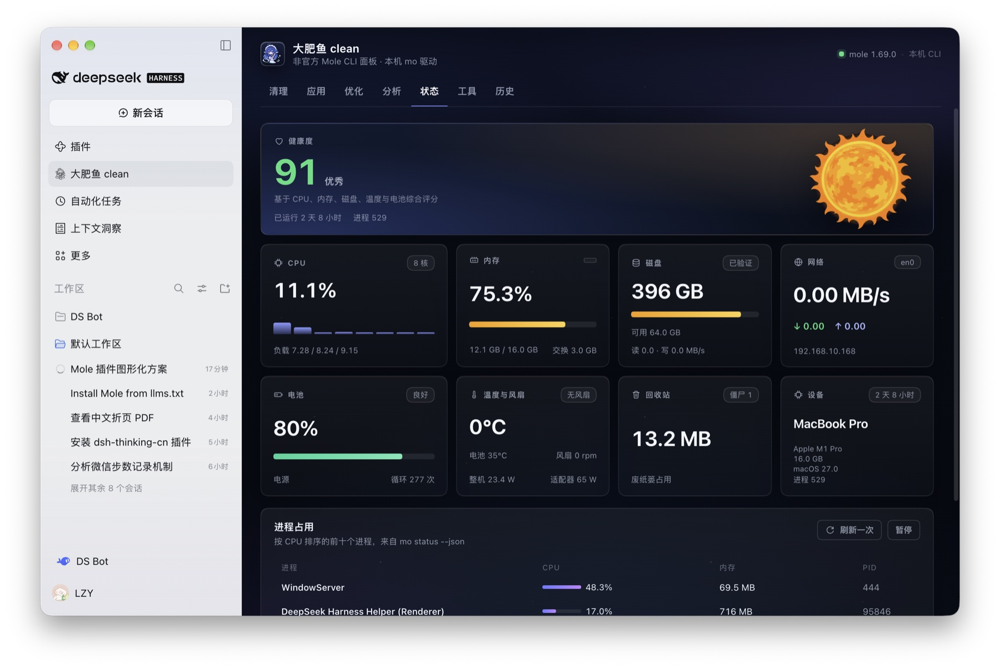
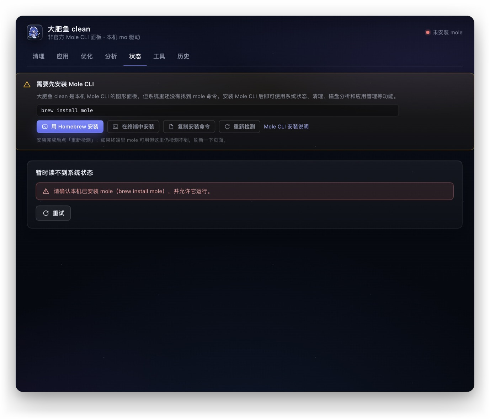
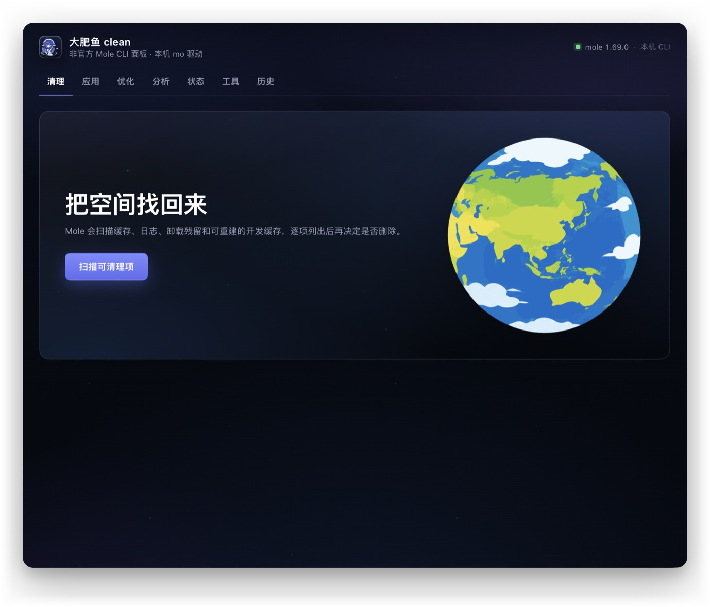
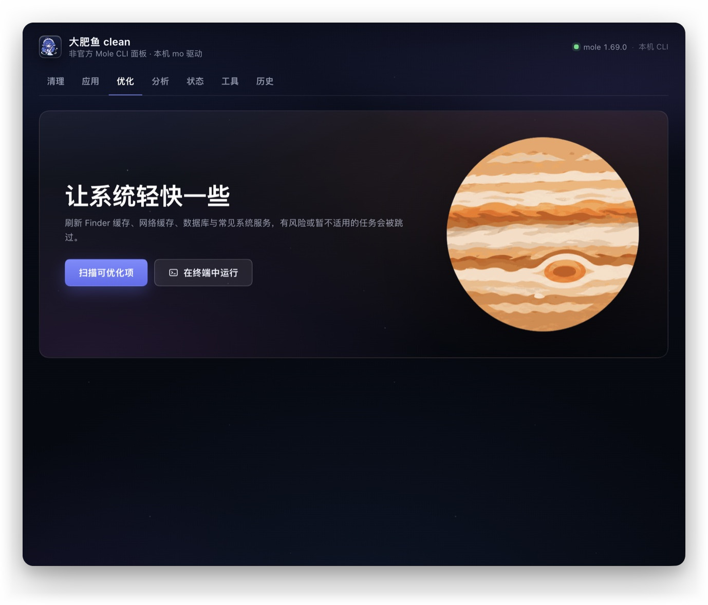
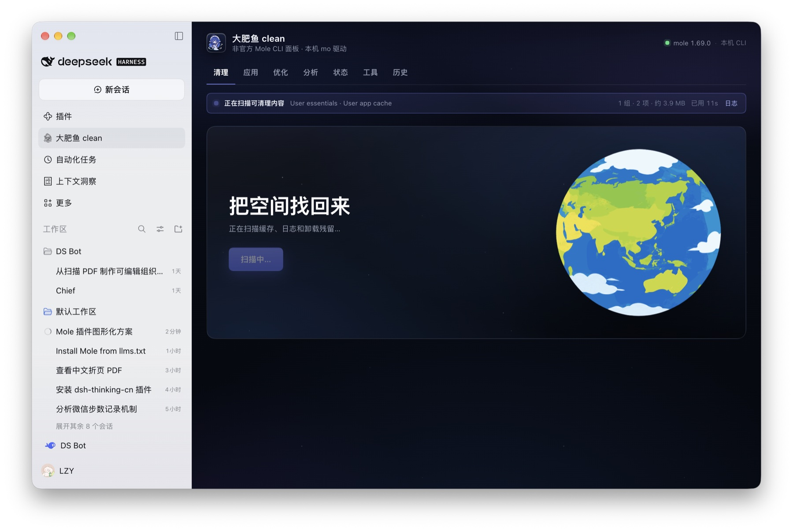

# 大肥鱼 clean

**Big Fat Fish clean** — an unofficial, immersive panel for the local
[Mole CLI](https://github.com/tw93/Mole) inside the DeepSeek Harness Web UI.
It covers the same ground as the CLI from one dark panel: system health,
cleanup previews with explicit confirmation, disk analysis, app inventory,
maintenance, cleanup history, and a guided Mole CLI install.



> Unofficial and not affiliated with the Mole project. The display name is
> intentionally distinct from Mole; Mole CLI is credited below. No Mole code or
> assets are bundled — the plugin runs the `mole` binary you install yourself.

## Install

**dsh-market / Plugins (after listing):** open **Plugins → Plugin Market**,
search for **Big Fat Fish clean / 大肥鱼 clean**, and click install.

**From GitHub source (no build scripts):**

```sh
dsh plugin --profile <profile> add github:lzyxczw-cyber/dafish-clean
```

**Or install the release tarball:**

```sh
dsh plugin --profile <profile> add https://github.com/lzyxczw-cyber/dafish-clean/releases/download/v1.0.1/dafish-clean-1.0.1.tgz
```

**npm:** the package name is reserved as `dafish-clean`; npm publication is
pending this account's npm login. Until then use one of the GitHub sources above.

After installing, refresh the DSH page (restart the host if it asks to) and open
**大肥鱼 clean** from the sidebar.

## Requirements and guided install

- macOS and the [Mole CLI](https://github.com/tw93/Mole). The panel looks for
  `mole` in Homebrew, `/usr/local/bin`, `~/.local/bin`, or `MOLE_BIN`.
- When the CLI is missing, the panel shows an install guide instead of failing:
  - **One-click install** with Homebrew: runs `brew install mole` as a
    background job, streams Homebrew's own output in the live progress line and
    re-checks automatically. It never runs `sudo`.
  - Fallbacks: install in Terminal, copy `brew install mole`, or (without
    Homebrew) copy Mole's official install script, then **Check again**.
- The plugin is macOS-only today (terminal hand-off uses `open` / Terminal).



## Tabs

| Tab | What it runs | Safety |
| --- | --- | --- |
| Status | `mole status --json`, refreshed every 3 s | read-only |
| Clean | `mole clean --dry-run`, then an explicit confirm to run `mole clean` | preview before removal |
| Apps | `mole uninstall --list` and `mole uninstall --dry-run <app>` | removal handed to Terminal |
| Optimize | `mole optimize --dry-run`, then an explicit confirm to run `mole optimize` | preview before maintenance |
| Analyze | `mole analyze --json <path>` with a treemap and drill-down | read-only |
| Tools | `mole purge / installer / slim --dry-run` | removal handed to Terminal |
| History | `mole history --json --limit 60` | read-only |





## Design

The panel is built to feel like a page of the Harness window rather than a
separate application: a Harness-style page header with an underline tab row, the
same spacing and type rhythm as host pages, fluid card grids that adapt to the
main column, and a full-bleed dark space background with user-supplied planet
illustrations. It does not copy Mole for Mac's window chrome or tab bar.

- Live progress: every long operation (previews, real clean/optimize, disk
  analysis, Mole CLI install) starts a background job. A single status line
  shows the current group/item from Mole's own output, counters, and a
  continuously updating elapsed time; a log toggle expands the recent output.
- Scan and analysis results are localized to Chinese: the CLI only prints English, so the panel maps Mole's own group names, task names, statuses and summaries to Chinese while leaving real file paths, app names and process names untouched.
- Tab switching keeps the running state and completed results: the panel state
  lives in a persistent store, so leaving a tab or the panel and coming back
  does not reset buttons or lose results.
- Artwork (Earth/Jupiter/Sun, mascot/line-art icons) was supplied by the plugin
  owner and embedded in the client bundle; no Mole application assets are
  redistributed.

## Safety model

- Reads run automatically; every destructive surface is previewed with `--dry-run`.
- `clean`, `optimize` and `purge --yes` only run after an explicit confirmation
  dialog. The panel never runs `sudo`; system-level cleanup is left to the
  user's Terminal.
- App uninstall, installer removal, slim and whitelist editing open a generated
  `.command` file in Terminal.app instead of pretending those steps can be
  automated.
- A job lock prevents overlapping destructive or same-kind scans.
- Mutating local routes require same-origin requests plus the `x-dsh-mole`
  header.

## Trademark, licensing and asset provenance

This is an **unofficial** integration, not a fork of Mole and not affiliated
with or endorsed by the Mole project.

- **Mole CLI** belongs to [tw93/Mole](https://github.com/tw93/Mole) and is
  licensed under GPL-3.0. This package bundles no Mole code, binary, skill,
  logo or Mole-for-Mac assets. It executes the user's own installed `mole`
  binary as a separate process and reads its JSON/text output.
- **"Mole" name**: the Mole project states that its name and logo are
  trademarks and that GPL covers code, not the brand. This package uses the
  name only descriptively ("for the Mole CLI") and is not published as an
  official Mole product.
- **Mole for Mac** (`mole.fit`) is a separate proprietary app with its own
  reserved name and assets. No assets from that app are included.
- **User-supplied artwork**: `assets/mascot*.png`, `assets/planet-*.png` and
  `icon.png` come from images provided by the plugin owner. Their rights are
  not established by this package; confirm the license before redistributing.

## License

MIT for this plugin's code. Mole CLI is GPL-3.0 and is not part of this package.
